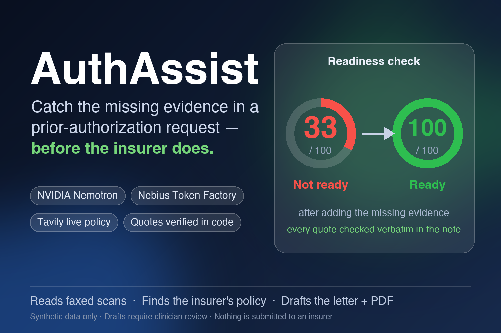
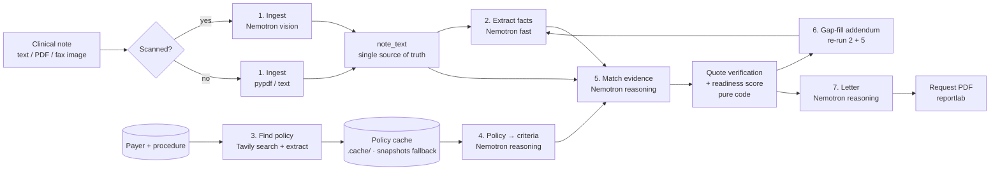

# AuthAssist

**AuthAssist catches the missing evidence in a prior-authorization request _before_ the insurer does.**



<!-- add a screenshot / GIF of the live UI here -->

Built for the **Nebius x NVIDIA Global AI Hackathon** (track: Best Apps and Agents) with **NVIDIA Nemotron** models on **Nebius Token Factory** and **Tavily** search + extract.

---

## The problem

US clinics must get insurer approval (prior authorization) before many procedures. Staff spend hours each week finding each insurer's rules, filling forms, and attaching evidence. Many requests are denied for avoidable reasons: the evidence existed in the chart but wasn't documented clearly against the insurer's criteria.

<!-- add sourced stats -->

## What it does

1. **Read the note:** paste text, or upload a PDF or a photographed/faxed note (the Nemotron vision model reads scans).
2. **Extract clinical facts:** symptoms, duration, treatments tried, red flags, exam findings, prior imaging. Every supporting span is checked against the note.
3. **Find the insurer's current policy:** Tavily searches the payer's own domain and extracts the full policy text (Medicare/CMS guidance as a fallback).
4. **Turn the policy into a checklist** of atomic, checkable criteria, each with a citation.
5. **Match evidence:** each criterion is marked met, unclear or missing, with an **exact quote** from the note. Code verifies every quote is verbatim, and anything unverifiable is downgraded. A **readiness score** is computed in code.
6. **Fill the gaps:** staff add the missing details as a labeled clinician addendum, re-check, and watch the score jump (e.g. 50 → 100).
7. **Draft the letter:** a letter of medical necessity plus a request-summary PDF (checklist, quotes, letter, policy source), for clinician review and signature. Nothing is ever submitted automatically.

Scope: **MRI lumbar spine without contrast (CPT 72148)** for low back pain; payers **Aetna** and **Molina**, plus **Medicare/CMS** fallback. More procedures can be added by adding a `config/procedures/*.yaml` file.

## Architecture



Every model and tool call is recorded in a **trace** (step, role, model ID, latency, tokens, success) and shown in the UI's "How it works · Model trace" tab.

## How we use NVIDIA Nemotron + Nebius Token Factory

All LLM calls go through one module, [`authassist/llm.py`](authassist/llm.py), which uses the OpenAI-compatible Token Factory endpoint (`NEBIUS_BASE_URL`). No other LLM provider is used anywhere. Exact model IDs are discovered with `scripts/list_models.py` and pinned in [`config/models.yaml`](config/models.yaml).

| Role | Model (Token Factory ID) | Why this model |
|---|---|---|
| `vision` | `nvidia/Nemotron-3.5-Super-VL` | Multimodal; transcribes faxed/scanned notes at ~99% fidelity. (Nano Omni is dedicated-endpoint only on Token Factory.) |
| `fast` | `nvidia/NVIDIA-Nemotron-3-Nano-30B-A3B` | Cheap, low-latency structured extraction, query writing, short asks (~3s per note) |
| `reasoning` | `nvidia/Nemotron-3-Ultra-550b-a55b` (fallback `nvidia/nemotron-3-super-120b-a12b`) | Policy → criteria, criteria ↔ evidence matching, letter drafting |

Nemotron's hidden reasoning is switched off for the `fast` and `vision` roles (`enable_thinking: false` in `config/models.yaml`); left on, Nano spent its whole token budget thinking and returned empty content.

**Where Token Factory helped.** One OpenAI-compatible endpoint serves all three Nemotron models, so each pipeline step uses the model that fits it, switched by editing `config/models.yaml` with no infrastructure to run. Nemotron 3 Ultra is used only where serious reasoning pays off (policy → criteria, evidence matching, the letter, ~11s per call); Nemotron 3 Nano handles the fast, frequent calls (fact extraction ~3s, short asks <1s); Nemotron 3.5 Super VL reads faxed scans (~3s per page, ~99% transcription accuracy). The per-step model trace in the UI shows this split live. A whole readiness check takes 10-20s end to end.

**Other Nebius services:** Token Factory only. The demo is hosted on Render, not Nebius AI Cloud. **Track:** Best Apps and Agents.

Reliability features: 3 retries with exponential backoff, automatic fallback model, JSON-schema prompting with robust parsing (strips `<think>` blocks and code fences, repairs trailing commas), and one self-repair retry with the validation error appended.

## How we use Tavily

- **Search** (`search_depth="advanced"`, `include_domains=<payer allow-list>`) with queries written by Nemotron plus a payer-specific hint, so results come from the insurer's own site, not blogs or billing aggregators.
- **Extract** pulls the full policy text from the best result. If it's too short, we try the next candidate.
- **Fallback:** if the payer's policy can't be found, we search CMS (Medicare) guidance and label it clearly as a fallback.
- **Caching:** extracted text and derived criteria are cached in `.cache/policies/` (git-ignored) with URL, retrieval timestamp and content hash. Repeat checks spend no credits, and `--refresh` forces a fresh lookup.
- **Citations and freshness:** every criterion links to its policy section and URL, and the UI shows the retrieval date and whether the policy was found live via Tavily or came from the cache.
- **Demo safety net:** [`data/policy_criteria_snapshots/`](data/policy_criteria_snapshots/) stores criteria lists only (no copyrighted policy text) with source URL and date. If Tavily is down, the UI says "Using cached policy criteria snapshot from <date>". Regenerate them with `python scripts/refresh_snapshots.py`.

## Quickstart

```bash
git clone <this repo> && cd authassist
uv venv --python 3.12 .venv && source .venv/bin/activate   # or python3.12 -m venv .venv
pip install -r requirements.txt
cp .env.example .env        # add NEBIUS_API_KEY and TAVILY_API_KEY

python scripts/list_models.py        # discover Nemotron model IDs → put them in config/models.yaml
python scripts/smoke_test.py         # one call per model role + one Tavily search

# CLI
python -m authassist.cli --case data/synthetic_notes/case_04
python -m authassist.cli --case data/synthetic_notes/case_04 \
  --addendum "Low back pain for 9 weeks. Completed 8 weeks of physical therapy from 08/20/2026 to 10/15/2026." \
  --letter out/case_04.pdf

# UI
streamlit run ui/app.py               # DEMO_MODE=false in .env enables uploads/paste

# API
uvicorn api.main:app --port 8000      # GET /health, POST /assess, POST /recheck, POST /letter

# Evaluation and tests
python eval/run_eval.py               # writes eval/results.md
pytest                                # no network: LLM and Tavily are faked
ruff check . && ruff format --check .

# Docker
docker build -t authassist .
docker run -p 8501:8501 --env-file .env authassist                     # UI
docker run -p 8000:8000 -e PORT=8000 --env-file .env authassist \
  uvicorn api.main:app --host 0.0.0.0 --port 8000                        # API
```

### Deploy (Render)

The repo includes a [`render.yaml`](render.yaml) blueprint (Docker, free plan, `DEMO_MODE=true`). In Render: **New → Blueprint →** select the repo, then set `NEBIUS_API_KEY` and `TAVILY_API_KEY` in the service's **Environment** settings. Secrets live only in the host's environment, never in files. Health check: `/_stcore/health`.

## Readiness score

The score is computed in [`authassist/scoring.py`](authassist/scoring.py), **never by the LLM**:

- `score = round(100 × mean(weight))` over **required** criteria, where met = 1, unclear = 0.5, missing = 0.
- Required = every criterion that is not a red-flag indication. If **any red flag** is documented (cauda equina signs, suspected malignancy, infection, fracture, progressive deficit), the `symptom_duration` and `conservative_therapy` criteria are **excused** (red-flag bypass).
- Status: **Ready** = all required criteria met; **Not ready** = any required criterion missing; otherwise **Needs attention**.

## Evaluation results

8 synthetic cases (2 of them scanned-fax images) cover: well-documented requests, missing conservative therapy, PT without duration, missing neuro exam, and two red-flag bypass scenarios. See [`eval/results.md`](eval/results.md) for per-criterion accuracy, outcome accuracy, quote-verification rate, latency per step, token totals, and failure cases.

**Latest run (8 synthetic cases, 2 scanned):**

| Metric | Result |
|---|---|
| Overall outcome accuracy | 8/8 (100%) |
| Per-criterion accuracy | 23/24 (96%) |
| Red-flag bypass accuracy | 7/8 (88%) |
| Evidence quotes verified verbatim | 57/57 (100%) |
| Vision transcription similarity (scans) | ~99% |
| Avg latency | extract 3s · match evidence 11s · whole check 10-20s |

**Known failure:** case 02 triggers a red-flag bypass that the expected answer does not. Molina's own policy lists abnormal reflexes/weakness as an imaging indication, so the radiculopathy findings legitimately match it. Five expectations are marked not-applicable because a payer's policy has no such criterion. Results vary slightly between runs (reasoning model, temperature 0.1): an earlier run missed case 05 until the matcher prompt was tightened. Medicare uses a hand-written criteria snapshot because the CMS pages are quality-measure specs, not coverage rules.

## Safety, privacy & limitations

- **Synthetic data only** in the demo; `DEMO_MODE=true` disables uploads and free text on the public deployment (UI and API).
- **No note text in logs:** uploads are processed in memory and never written to disk; logs contain only metadata (case IDs, criterion IDs, timings).
- **Human in the loop:** every output is a draft that requires clinician review and signature. Nothing is auto-submitted, and nothing claims approval.
- **Anti-hallucination:** every evidence quote must appear verbatim in the note (whitespace/case-normalized). Unverifiable quotes are flagged and `met` is downgraded to `unclear`.
- **Policies change:** every criterion shows its source and retrieval date.
- **Not HIPAA-compliant yet.** Not legal or medical advice. One procedure; tested on 2 payers plus Medicare/CMS fallback. Model-based criteria extraction and matching can be wrong (see the failure cases in the eval).

## Path to production & business model

- **Compliance:** HIPAA administrative, physical and technical safeguards; BAAs with every vendor (LLM inference, search, hosting); audit logging; encryption at rest and in transit; SOC 2.
- **Integration:** pull notes from the EHR via **FHIR** (DocumentReference, Condition, Procedure); push results back as a task or note; connect to payer **Prior Authorization APIs** (FHIR Da Vinci CRD/DTR/PAS), which CMS-0057-F requires many payers to provide from **January 1, 2027**.
- **Coverage:** add procedures (knee MRI, sleep studies, specialty drugs) via config, plus a policy watcher that re-fetches policies and flags changes.
- **Business model:** per-request pricing or a monthly subscription for small and mid-sized clinics. Value comes from fewer avoidable denials, less staff time per request, and faster time to treatment.

## License

[MIT](LICENSE)
